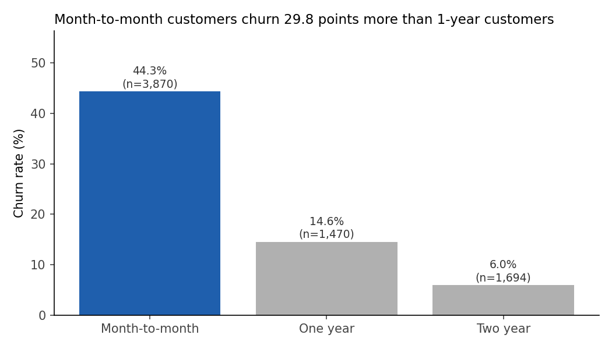
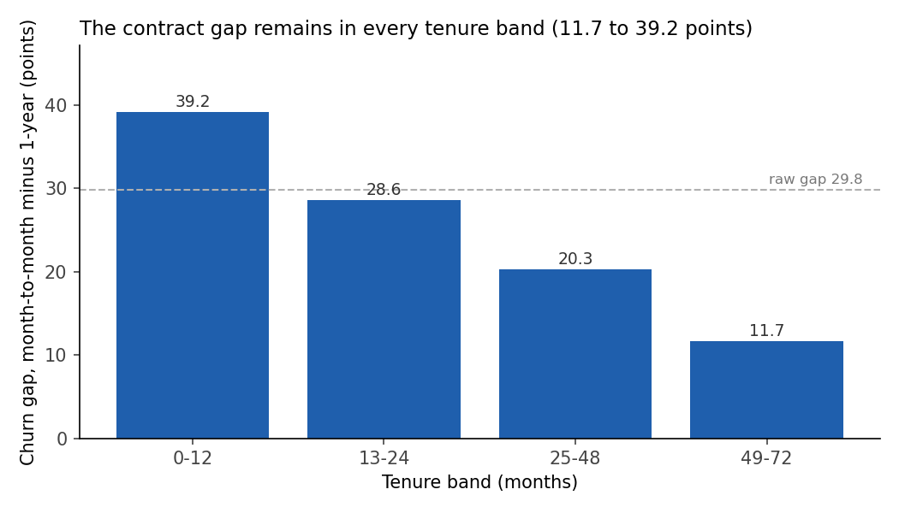
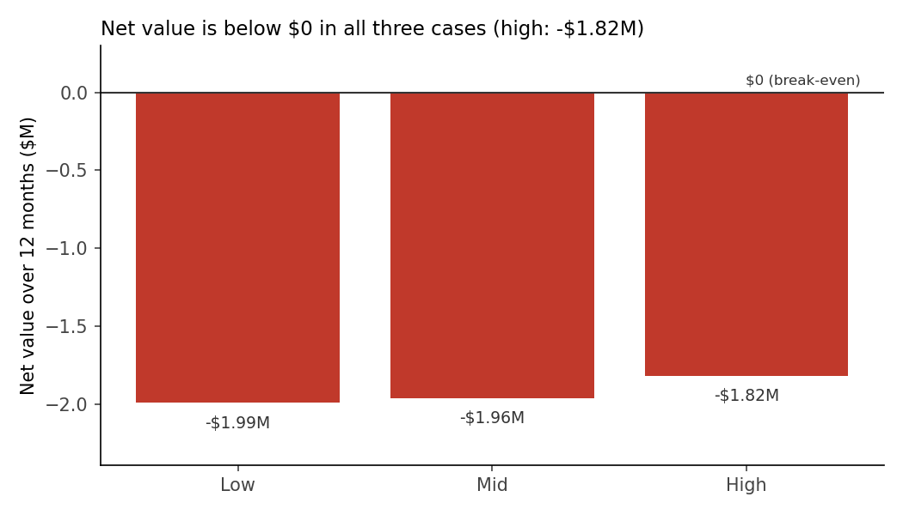

# Agentic Analyst Kit

Business analysis with an AI agent: a brief, a reviewer agent, and checks you can trust.
Built in the AI Fluency Sprint (BAX 462, UC Davis).

## The case: the $2M decision
The VP of Marketing wants to spend $2M to move month-to-month customers to 1-year contracts.
Should we fund it?

## How this repo works
| File | What it is |
| --- | --- |
| `CLAUDE.md` | Team standards. The agent reads them in every session |
| `briefs/` | One brief per business question |
| `.claude/agents/` | Specialist agents, for example a reviewer |
| `.claude/hooks/` | Guardrails the agent cannot skip (raw data is read-only) |
| `data/raw/` | Raw data. Read-only |
| `runs/` | Outputs: recommendation, charts, logs |

## Steps (prompts only, no code)
Copy-paste prompts for every step: **[PROMPTS.md](PROMPTS.md)**. Use **claude.ai/code**, not the normal Claude chat.

0. **Know the data:** profile the data, record 3 data issues, and add 1 rule to `CLAUDE.md`.
1. **Brief:** let the agent interview you and write `briefs/2m-campaign.md`.
2. **Reviewer:** create a reviewer agent. Compare its checks with 2 of your own.
3. **Run:** in Plan mode, read the plan, change 1 step, approve.
4. **Verify and decide:** ask for evidence. Compare it with your 3 data issues. Write your own recommendation.
5. **Deliver:** fix what the review found, push, then merge to `main`.

## Results
- **My recommendation:** Do not fund the $2M campaign: even at a 20% switch rate and the full raw churn gap, it loses about $1.8M in 12 months.
  Instead, test a small, low-cost contract offer on a random sample of month-to-month customers. Measure the switch rate and churn against a control group.
- **Full report with charts:** [runs/telco/recommendation.md](runs/telco/recommendation.md)
- **The brief I wrote:** [briefs/2m-campaign.md](briefs/2m-campaign.md)
- **My team rule:** see "Analysis rules" in [CLAUDE.md](CLAUDE.md)
- **The reviewer agent:** [.claude/agents/reviewer.md](.claude/agents/reviewer.md) and its review: [runs/telco/review.md](runs/telco/review.md)

### For the marketing team: the $2M campaign in 3 charts

| Key number | Value |
| --- | --- |
| Month-to-month customers | 3,870 |
| Their monthly revenue | $257,150 ($66.45 average) |
| Churn: month-to-month vs 1-year | 44.3% vs 14.6% |
| Gap after controls for tenure, internet type, and payment method | 13.3 points |
| Net value in 12 months (low / mid / high) | -$1.99M / -$1.96M / -$1.82M |

**1. Month-to-month customers churn much more.**

Month-to-month customers churn at 44.3%. 1-year customers churn at 14.6%.

**2. The gap is not only a tenure effect.**

Month-to-month customers churn more in every tenure band. The gap is largest for new customers.

**3. But the campaign does not pay back.**

In all three cases, the revenue saved is far below the $2M cost. The gap is associated with contract type. The data does not show that a contract change causes lower churn.

Source: [runs/telco/recommendation.md](runs/telco/recommendation.md). Every number comes from `runs/telco/analysis.py`.

## Data
**Source:** IBM Telco Customer Churn sample dataset (IBM Sample Data Sets), a fictional phone and internet company with 7,043 customers. Public copy: [kaggle.com/datasets/blastchar/telco-customer-churn](https://www.kaggle.com/datasets/blastchar/telco-customer-churn).

`data/raw/telco_v2.csv` is a modified version made for teaching. Some rows and columns were changed or added, so results differ from the original dataset.
