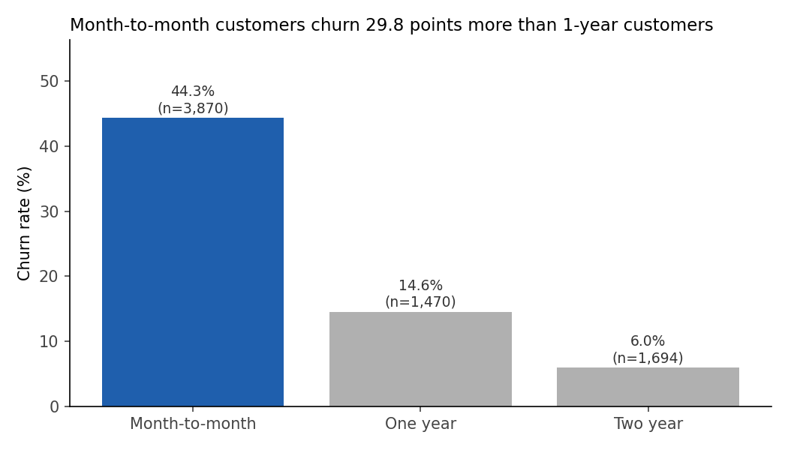
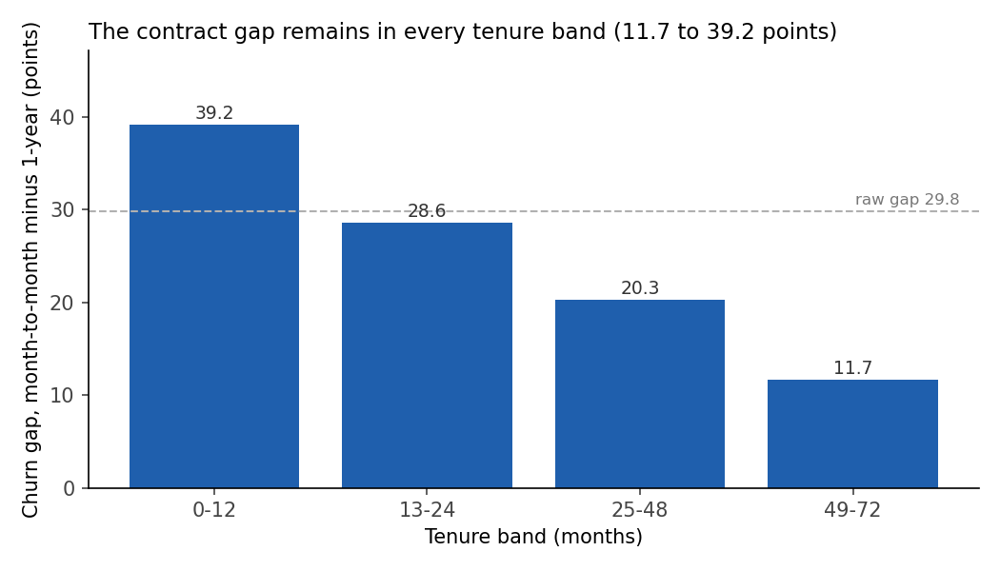
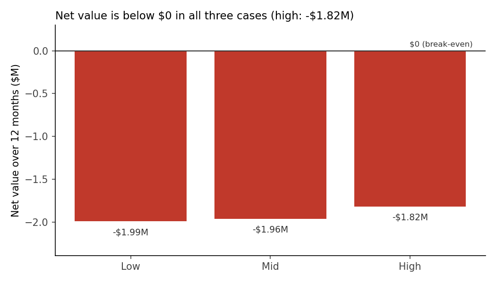

# $2M contract campaign: recommendation

## 1. Summary

**Recommendation: Do not fund (`do_not_fund`).** Even with the most favorable assumptions, the campaign saves less revenue than it costs.

**What we found**
- Month-to-month customers churn more than 1-year customers: 44.3% vs 14.6% (**derived**: churned / customers). The raw gap is 29.8 pp (**derived**).
- The gap remains after controls for tenure, internet type, and payment method: 13.3 pp (**derived**; 95% range 10.1 pp to 17.1 pp, **derived** by bootstrap). This is 45% of the raw gap (**derived**: 13.3 pp / 29.8 pp). The gap is positive in every tenure band.
- There are 3,870 month-to-month customers (**data**). They pay $257,150 per month in total (**derived**: sum of `MonthlyCharges`), or $66.45 on average (**derived**: total / customers).
- Net value over 12 months is -$1,989,762 (low), -$1,959,048 (mid), and -$1,816,189 (high) (**derived**). The high case is below $0, so the decision rule says `do_not_fund`.

**How sure we are:** high for the decision, medium for the size of the gap. The high case uses the largest values for every assumption and still loses $1,816,189 (**derived**). To break even at a 10% switch rate, the campaign must cut churn by 648 pp for each switched customer (**derived**). That is not possible, because a churn rate cannot fall by more than 100 points. The data is observational, so the gap is "associated with" contract type. It may not be caused by it.

**Value range:** net value from -$1,989,762 to -$1,816,189 (**derived**). Both duplicate runs give `do_not_fund` (second run: -$1,988,395 to -$1,810,204, **derived**).

**Data issues:** 211 duplicate IDs with conflicting Churn (two runs). 200 `MonthlyCharges` values 100 times too large (191 fixed, 9 rows removed by user decision). 11 blank `TotalCharges` set to 0. `RetentionOfferAccepted` excluded (leakage). All counts are **data**.

**Risks**
- The gap after controls is 45% of the raw gap (second run: 49%; **derived**: gap after controls / raw gap). This fired a stop-and-ask rule in the brief. The user decided to continue, because no gap size in the range changes the decision.
- Other variables may explain part of the gap. Example: 86% of loyalty app users are month-to-month (**derived**; see "Loyalty app users by contract" in the Appendix). We did not control for this column. App users churn more overall, but less than non-users within each contract type.
- Customers who accept an offer may be the ones least likely to churn. Then the real churn effect is smaller than our estimates.
- The model counts only 12 months of revenue from saved customers. It ignores campaign effects on customers who do not switch.

**Next step:** do not fund the $2M campaign. If the business still wants contract migration, test a small, low-cost offer on a random sample of month-to-month customers. Measure the switch rate and churn against a control group.

## 2. Charts



Month-to-month customers churn at 44.3%, compared with 14.6% for 1-year and 6.0% for 2-year customers (**derived**: churned / customers).



In every tenure band, month-to-month customers churn more than 1-year customers, so tenure alone does not explain the gap.



All three net values are below the $0 break-even line, so the campaign does not pay back its $2M cost in 12 months.

## 3. Appendix

### Data source and size
- File: `data/raw/telco_v2.csv`. A teaching version of the IBM Telco Customer Churn sample (fictional company).
- Raw: 7,254 rows, 7,043 unique `customerID`, 23 columns (**data**).
- After cleaning: 7,034 rows in the main run, 7,034 in the second run (**data**). One row per customer.

### Data dictionary
| Column | Meaning | Type |
| --- | --- | --- |
| customerID | Customer ID. One ID = one customer | text |
| gender | Customer gender | text |
| SeniorCitizen | 1 = senior citizen (age limit unknown) | integer 0/1 |
| Partner | Has a partner | Yes/No |
| Dependents | Has dependents | Yes/No |
| tenure | Months as a customer | integer |
| PhoneService | Has phone service | Yes/No |
| MultipleLines | Has more than one phone line | text |
| InternetService | Internet type: DSL, Fiber optic, No | text |
| OnlineSecurity | Has online security add-on | text |
| OnlineBackup | Has online backup add-on | text |
| DeviceProtection | Has device protection add-on | text |
| TechSupport | Has tech support add-on | text |
| StreamingTV | Has streaming TV | text |
| StreamingMovies | Has streaming movies | text |
| Contract | Contract type: Month-to-month, One year, Two year | text |
| PaperlessBilling | Gets paperless bills | Yes/No |
| PaymentMethod | How the customer pays | text |
| MonthlyCharges | Current monthly bill ($) | number |
| TotalCharges | Total billed to date ($). Stored as text in the raw file | number (text in raw) |
| Churn | Yes = the customer left in the last month | Yes/No |
| LoyaltyAppUser | Uses the loyalty app | Yes/No |
| RetentionOfferAccepted | Accepted a retention offer. Filled only for churners. Excluded | Yes/No/blank |

### Raw data profile
| Column | Raw type | Blanks | Min | Max |
| --- | --- | --- | --- | --- |
| customerID | object | 0 |  |  |
| gender | object | 0 |  |  |
| SeniorCitizen | int64 | 0 | 0 | 1 |
| Partner | object | 0 |  |  |
| Dependents | object | 0 |  |  |
| tenure | int64 | 0 | 0 | 72 |
| PhoneService | object | 0 |  |  |
| MultipleLines | object | 0 |  |  |
| InternetService | object | 0 |  |  |
| OnlineSecurity | object | 0 |  |  |
| OnlineBackup | object | 0 |  |  |
| DeviceProtection | object | 0 |  |  |
| TechSupport | object | 0 |  |  |
| StreamingTV | object | 0 |  |  |
| StreamingMovies | object | 0 |  |  |
| Contract | object | 0 |  |  |
| PaperlessBilling | object | 0 |  |  |
| PaymentMethod | object | 0 |  |  |
| MonthlyCharges | float64 | 0 | 18.25 | 11515.0 |
| TotalCharges | object | 11 | 18.8 | 8684.8 |
| Churn | object | 0 |  |  |
| LoyaltyAppUser | object | 0 |  |  |
| RetentionOfferAccepted | object | 5221 |  |  |

`TotalCharges` blanks are single-space text values. `MonthlyCharges` max is the 100-times error.

### Cleaning summary
| Fix | Rows (main run) | Action |
| --- | --- | --- |
| Duplicate `customerID` with different Churn | 211 rows removed | Kept the Churn = Yes row. Second run kept the No row |
| `MonthlyCharges` 100 times too large, check passed | 191 | Divided by 100 |
| `MonthlyCharges` 100 times too large, check failed | 9 rows removed | User decision |
| Blank `TotalCharges` (tenure 0) | 11 | Set to 0 |
| `RetentionOfferAccepted` | column | Excluded (leakage) |
| **Rows** | 7,254 → 7,034 | |

Full row-by-row list: `cleaning_log.md`.

### Key results: main run
**Churn by contract**

| Contract | Customers (data) | Churned (data) | Churn rate (derived) |
| --- | --- | --- | --- |
| Month-to-month | 3,870 | 1,716 | 44.3% |
| One year | 1,470 | 214 | 14.6% |
| Two year | 1,694 | 101 | 6.0% |

Raw gap = month-to-month churn rate − 1-year churn rate = 44.3% − 14.6% = 29.8 pp (**derived**).

**Gap within tenure bands**

| Tenure band (months) | MTM customers (data) | MTM churn (derived: churned / customers) | 1-year customers (data) | 1-year churn (derived: churned / customers) | Gap (derived: MTM churn − 1-year churn) |
| --- | --- | --- | --- | --- | --- |
| 0-12 | 1,989 | 53.1% | 122 | 13.9% | 39.2 pp |
| 13-24 | 737 | 38.8% | 196 | 10.2% | 28.6 pp |
| 25-48 | 802 | 34.8% | 518 | 14.5% | 20.3 pp |
| 49-72 | 342 | 27.8% | 634 | 16.1% | 11.7 pp |

**Gap after controls (logistic regression)**

A logistic regression estimates the chance of churn from several variables at the same time. Model: `churn ~ C(Contract, Treatment('One year')) + tenure + C(InternetService) + C(PaymentMethod)`. All 7,034 customers, including 2-year customers.

Gap after controls = average over month-to-month customers of (predicted churn as month-to-month − predicted churn as 1-year) = 13.27 pp (**derived**). 95% range from 200 bootstrap samples (resampling the customers with replacement, seed 42): 10.08 pp to 17.10 pp.

| Term | Coef. | Std.Err. | P>|z| |
| --- | --- | --- | --- |
| Intercept | -1.006 | 0.1307 | 0.0 |
| C(Contract, Treatment('One year'))[T.Month-to-month] | 0.6479 | 0.0944 | 0.0 |
| C(Contract, Treatment('One year'))[T.Two year] | -0.3874 | 0.1321 | 0.0034 |
| C(InternetService)[T.Fiber optic] | 0.9808 | 0.0708 | 0.0 |
| C(InternetService)[T.No] | -0.7038 | 0.1057 | 0.0 |
| C(PaymentMethod)[T.Credit card (automatic)] | -0.0877 | 0.1026 | 0.3929 |
| C(PaymentMethod)[T.Electronic check] | 0.3781 | 0.087 | 0.0 |
| C(PaymentMethod)[T.Mailed check] | -0.1243 | 0.1036 | 0.2301 |
| tenure | -0.0272 | 0.0019 | 0.0 |

**Month-to-month revenue**
- Customers: 3,870 (**data**).
- Monthly revenue: $257,150 total (**derived**: sum of `MonthlyCharges` for MTM customers, after the fix), $66.45 average (**derived**: total / customers).

**Net value (main run)**

Revenue saved = MTM customers × switch rate × churn effect × average monthly charge × 12. Net value = revenue saved − $2,000,000 (**derived**).

| Case | Switch rate (assumption) | Churn effect (assumption, from the gaps) | Customers switched (derived: MTM customers × switch rate) | Customers saved (derived: switched × churn effect) | Revenue saved, 12 mo (derived: saved × average charge × 12) | Net value (derived: revenue saved − $2M) |
| --- | --- | --- | --- | --- | --- | --- |
| low | 5% | 6.6 pp | 194 | 13 | $10,238 | -$1,989,762 |
| mid | 10% | 13.3 pp | 387 | 51 | $40,952 | -$1,959,048 |
| high | 20% | 29.8 pp | 774 | 231 | $183,811 | -$1,816,189 |

**Both duplicate runs**

| Result | Main run (keep Yes) | Second run (keep No) |
| --- | --- | --- |
| Customers (data) | 7,034 | 7,034 |
| Raw gap (derived) | 29.8 pp | 30.8 pp |
| Gap after controls (derived) | 13.3 pp | 15.0 pp |
| MTM customers (data) | 3,870 | 3,870 |
| MTM monthly revenue (derived: sum) | $257,150 | $257,150 |
| Net value: low (derived) | -$1,989,762 | -$1,988,395 |
| Net value: mid (derived) | -$1,959,048 | -$1,953,580 |
| Net value: high (derived) | -$1,816,189 | -$1,810,204 |
| Decision (derived: decision rule) | do_not_fund | do_not_fund |

**Second run net value**

| Case | Switch rate (assumption) | Churn effect (assumption, from the gaps) | Customers switched (derived: MTM customers × switch rate) | Customers saved (derived: switched × churn effect) | Revenue saved, 12 mo (derived: saved × average charge × 12) | Net value (derived: revenue saved − $2M) |
| --- | --- | --- | --- | --- | --- | --- |
| low | 5% | 7.5 pp | 194 | 15 | $11,605 | -$1,988,395 |
| mid | 10% | 15.0 pp | 387 | 58 | $46,420 | -$1,953,580 |
| high | 20% | 30.8 pp | 774 | 238 | $189,796 | -$1,810,204 |

**Churn drivers (main run)**

"Overall" compares the group with all other customers. "Within each contract" repeats the comparison inside each contract type (groups of 30 or more customers). "higher" means the group churns more. Differences under 0.5 points count as "none".

| Variable | Group compared with the rest | Group n (data) | Group churn (derived) | Rest churn (derived) | Overall (derived) | Within each contract (derived) |
| --- | --- | --- | --- | --- | --- | --- |
| Contract | Month-to-month | 3,870 | 44.3% | 10.0% | higher | not_checked |
| tenure | tenure 0-12 months | 2,178 | 49.4% | 19.7% | higher | mixed |
| InternetService | Fiber optic | 3,096 | 43.7% | 17.2% | higher | higher |
| PaymentMethod | Electronic check | 2,363 | 46.8% | 19.8% | higher | higher |
| PaperlessBilling | Paperless billing = Yes | 4,169 | 35.4% | 19.4% | higher | higher |
| SeniorCitizen | SeniorCitizen = 1 | 1,142 | 42.6% | 26.2% | higher | mixed |
| LoyaltyAppUser | LoyaltyAppUser = Yes | 3,235 | 33.5% | 24.9% | higher | lower |

**Loyalty app users by contract**

| Contract | App users (data) | Share of app users | Non-users (data) | Share of non-users |
| --- | --- | --- | --- | --- |
| Month-to-month | 2,774 | 85.7% | 1,096 | 28.8% |
| One year | 255 | 7.9% | 1,215 | 32.0% |
| Two year | 206 | 6.4% | 1,488 | 39.2% |

Share = customers in the row / all customers with that `LoyaltyAppUser` value (**derived**).

### Assumptions
| Assumption | Low | Mid | High | Set by | Why |
| --- | --- | --- | --- | --- | --- |
| Switch rate | 5% | 10% | 20% | The user | Share of MTM customers who accept a 1-year contract; no data in the file |
| Churn effect | 6.6 pp (half the gap after controls) | 13.3 pp (gap after controls) | 29.8 pp (raw gap) | The user | The gap after controls may still include other differences, so low is half of it |
| Horizon | 12 months | 12 months | 12 months | The user | One year of revenue from saved customers |
| Campaign cost | $2,000,000 | $2,000,000 | $2,000,000 | VP of Marketing (case) | Given in the case |
| Charges match tolerance | 10% | 10% | 10% | The analyst | Allows for price changes over the customer's tenure |
| Tenure bands | 0–12, 13–24, 25–48, 49–72 | | | The analyst | Equal-ish groups for the within-band check |

Break-even checks (**derived**):
- At a 10% switch rate, break-even churn effect = $2,000,000 / (3,870 × 10% × $66.45 × 12) = 648.1 pp.
- At the raw gap, break-even switch rate = $2,000,000 / (3,870 × 29.8 pp × $66.45 × 12) = 217.6%.

### Run the analysis again
From the repo root:

```bash
python3 runs/telco/analysis.py --force
```

Needs Python 3 with pandas, numpy, statsmodels, and matplotlib. The script writes every file in `runs/telco/`.

Use `--force`. Without it, the script stops when a stop-and-ask rule from the brief fires, and it writes no files. In this analysis, the rule "gap after controls is less than half the raw gap" fires. The user decided to continue, so `--force` records that decision.
